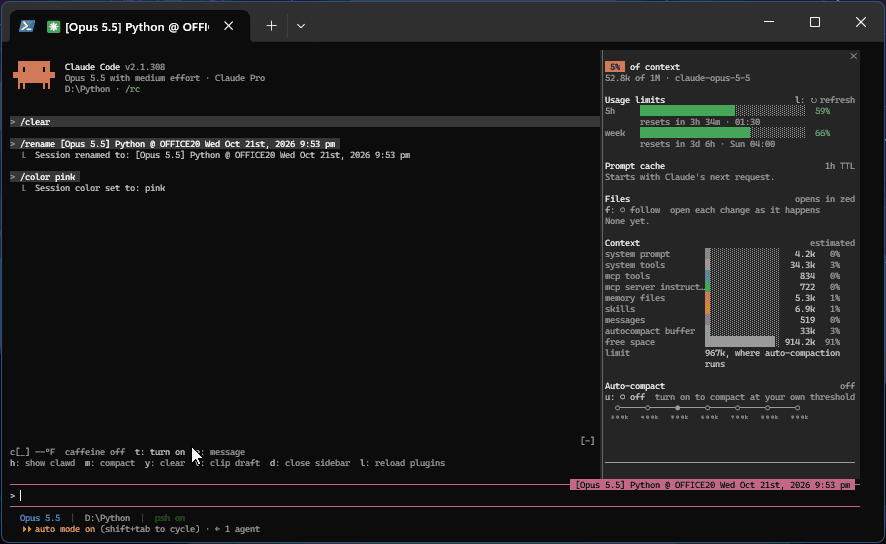

# clawd-buddy

> **Unofficial fan mod.** Clawd is Anthropic's mascot, and his name and sprites
> belong to Anthropic. This mod is not made, endorsed or supported by Anthropic.

An animated Clawd above your Claude Code prompt, with a live dashboard under him:
a context forecast, the prompt cache countdown, your 5-hour and weekly limits,
and a `/context` style breakdown. Runs in the terminal and the desktop app's Code
tab. Needs Claude Code 2.1.289 or later.



## Install

```
/plugin install clawd-buddy --marketplace lperezmo/clawd-buddy-mod
```

## What you get

- **Clawd:** locks in while Claude works, chills when it goes quiet, celebrates a
  long turn and hops when you talk to him. 8 rides and 36 acts from claude.dev.
- **The line under him:** context fill as weather, the cache countdown, and what
  is left of your 5-hour and weekly limits.
- **Context view:** the window by category, growth per turn and headroom before
  auto-compaction.
- **Sidebar:** `d` moves the lines into a pane beside the conversation.
- **Compaction:** compact or clear with a double press, or auto-compact at a
  threshold you pick.
- **Files:** opens the files Claude touches in your editor, at the changed line.
- **`/clawd`** commands, and **`/multiply`** on Windows to open more sessions.

## Privacy

It reads session figures, tool names and file paths, never your prompts beyond
spotting "thanks" or "yay", and sends nothing unless you press `count exactly`.
The full list is in the repository README.

## More

Full docs: [README](https://github.com/lperezmo/clawd-buddy-mod#readme).
License: MIT, see [LICENSE](LICENSE); Clawd's sprites and the token-weather parts
are not covered by it, see [NOTICE](NOTICE).
